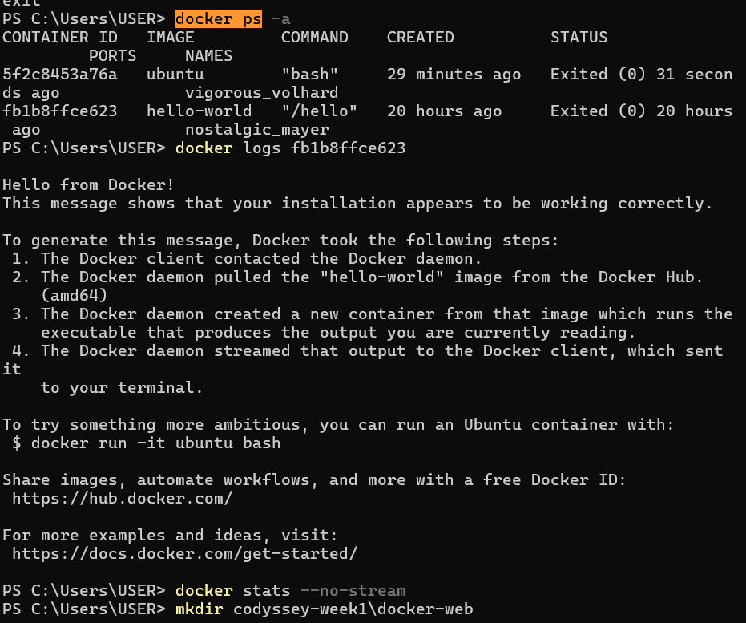
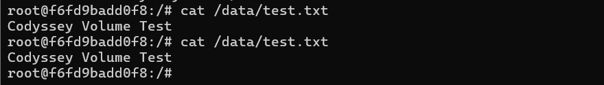
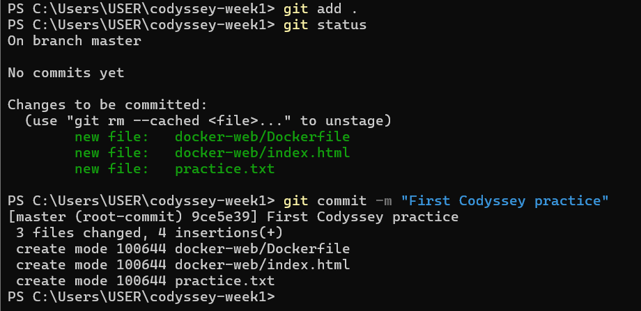
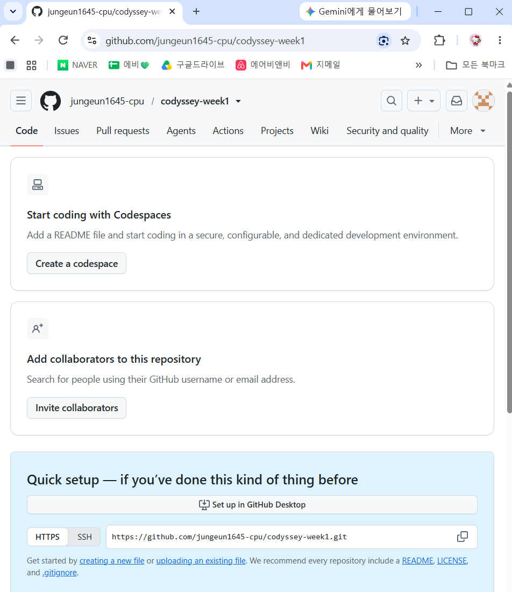
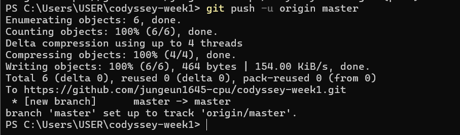

# Codyssey Week 1 Practice

PowerShell, Linux, Docker, Git & GitHub 기초 실습 기록

## 1. 실습 목표

- Windows PowerShell 기본 명령어 익히기
- Linux 파일 관리 및 권한 변경 실습
- Docker 이미지와 컨테이너 관리
- Dockerfile을 이용한 Nginx 웹서버 구축
- 포트 매핑, 바인드 마운트, 볼륨 실습
- Git과 GitHub를 이용한 프로젝트 버전 관리

## 2. 실습 환경

- 운영체제: Windows
- 터미널: Windows PowerShell
- Git: 2.56.1.windows.1
- Docker CLI: 29.9.3
- Docker Desktop: 4.99.0
- Linux: Ubuntu Docker 컨테이너
- 웹서버: Nginx Alpine

## 3. PowerShell 기본 명령어

Windows PowerShell에서 폴더 및 파일을 관리하는 명령어를 실습했다.

```powershell
pwd
ls
ls -Force
mkdir codyssey-week1
cd codyssey-week1
New-Item practice.txt -ItemType File
Set-Content practice.txt "Hello Codyssey"
Get-Content practice.txt
Copy-Item practice.txt practice-copy.txt
Move-Item practice-copy.txt practice-backup.txt
Remove-Item practice-backup.txt
```

**실습 결과**

- 현재 작업 위치 및 파일 목록 확인
- 숨김 파일을 포함한 목록 확인
- 폴더와 파일 생성
- 파일 내용 작성 및 확인
- 파일 복사, 이동, 삭제 완료

## 4. Linux 기본 명령어 및 권한 변경

Docker Ubuntu 컨테이너에서 Linux 명령어를 실습했다.

```bash
pwd
ls -la
mkdir /tmp/codyssey
cd /tmp/codyssey
touch practice.txt
ls -l practice.txt
chmod 755 practice.txt
chmod 644 practice.txt
echo "Hello Codyssey" > practice.txt
cat practice.txt
cp practice.txt practice-copy.txt
mv practice-copy.txt practice-backup.txt
rm practice-backup.txt
```

**파일 권한**

- `r`: 읽기(Read)
- `w`: 쓰기(Write)
- `x`: 실행(Execute)
- `chmod 755`: 소유자 rwx, 그룹 r-x, 기타 사용자 r-x
- `chmod 644`: 소유자 rw-, 그룹 r--, 기타 사용자 r--

**실습 결과**

파일 권한을 755와 644로 변경하고, 파일 생성·복사·이동·삭제 명령어를 실행했다.

## 5. Docker 기본 명령어

Docker 설치 후 다음 명령어를 실행했다.

```powershell
docker --version
docker info
docker run hello-world
docker images
docker ps
docker ps -a
docker logs fb1b8ffce623
docker stats --no-stream
docker run -it ubuntu bash
```

**실습 결과**

- Docker 설치 및 버전 확인
- Docker 엔진 정보 확인
- hello-world 컨테이너 실행 성공
- Docker 이미지와 컨테이너 목록 확인
- 컨테이너 실행 로그 확인
- Ubuntu 컨테이너 실행 및 Linux 명령어 실습

### Docker 기본 명령어 및 실행 로그



## 6. Dockerfile 및 Nginx 웹서버 구축

Dockerfile을 작성하여 Nginx 웹서버 이미지를 생성했다.

**Dockerfile**

```dockerfile
FROM nginx:alpine
COPY index.html /usr/share/nginx/html/index.html
```

**index.html**

```html
<h1>Hello Codyssey!</h1>
```

**Docker 이미지 빌드**

```powershell
docker build -t codyssey-web .
```

**웹서버 실행**

```powershell
docker run -d --name codyssey-server -p 8080:80 codyssey-web
docker run -d --name codyssey-server2 -p 8081:80 codyssey-web
```

**실습 결과**

- `http://localhost:8080` 접속 성공
- `http://localhost:8081` 접속 성공
- 직접 작성한 `Hello Codyssey!` 웹페이지 출력 확인

### Nginx 기본 웹서버 실행


### 직접 만든 HTML 웹페이지


## 7. Docker 포트 연결 및 바인드 마운트

Docker 포트 매핑을 통해 두 개의 웹서버를 실행했다.

이후 바인드 마운트를 이용해 Windows에 저장된 HTML 파일과 Docker 컨테이너를 연결했다.

**바인드 마운트 실행**

```powershell
docker run -d --name codyssey-bind -p 8080:80 --mount "type=bind,source=${PWD}\index.html,target=/usr/share/nginx/html/index.html,readonly" codyssey-web
```

**HTML 파일 수정**

```powershell
Set-Content index.html "<h1>Docker Bind Mount Success!</h1>"
```

**실습 결과**

- Windows에서 HTML 파일 수정
- Docker 이미지를 다시 빌드하지 않고 웹페이지 내용 변경
- `localhost:8080`에서 `Docker Bind Mount Success!` 출력 확인
- `localhost:8081`에서는 기존 웹페이지 유지

### Docker 웹서버 실행 및 바인드 마운트 설정 과정


### 바인드 마운트 변경 결과


## 8. Docker 볼륨 데이터 보존

Docker 볼륨을 생성하고, 컨테이너 삭제 후에도 데이터가 유지되는지 확인했다.

**볼륨 생성**

```powershell
docker volume create codyssey-data
```

**첫 번째 Ubuntu 컨테이너 실행**

```powershell
docker run -it --name codyssey-volume -v codyssey-data:/data ubuntu bash
```

**컨테이너 내부에서 파일 생성**

```bash
echo "Codyssey Volume Test" > /data/test.txt
cat /data/test.txt
exit
```

**기존 컨테이너 삭제**

```powershell
docker rm codyssey-volume
```

**새로운 컨테이너 실행**

```powershell
docker run -it --name codyssey-volume-new -v codyssey-data:/data ubuntu bash
```

**기존 파일 확인**

```bash
cat /data/test.txt
```

**실행 결과**

```text
Codyssey Volume Test
```

**실습 결과**

기존 컨테이너를 삭제한 후 새로운 컨테이너에 동일한 볼륨을 연결했을 때 파일이 그대로 유지되는 것을 확인했다.

### Docker 볼륨 데이터 보존 확인



## 9. Git 및 GitHub 실습

Git을 이용해 프로젝트의 변경 이력을 관리하고 GitHub에 업로드했다.

**Git 설치 및 사용자 설정 확인**

```powershell
git --version
git config --global user.name
git config --global user.email
```

**Git 저장소 생성 및 첫 커밋**

```powershell
git init
git status
git add .
git commit -m "First Codyssey practice"
```

**GitHub 원격 저장소 연결**

```powershell
git remote add origin https://github.com/jungeun1645-cpu/codyssey-week1.git
git remote -v
```

**GitHub 업로드**

```powershell
git push -u origin master
```

**실습 결과**

- Git 저장소 생성 성공
- 파일 3개를 첫 번째 커밋으로 저장
- 커밋 ID: `9ce5e39`
- GitHub 원격 저장소 연결 성공
- `master` 브랜치 업로드 성공
- GitHub 웹사이트에서 업로드 파일 확인

**GitHub 저장소**

https://github.com/jungeun1645-cpu/codyssey-week1

### Git 첫 번째 커밋



### GitHub 저장소 생성



### GitHub 첫 업로드



## 10. 트러블슈팅

### 사례 1. Docker Desktop 설치 중 가상화 기능 오류

**문제 상황**

Docker Desktop 설치 과정에서 Windows Virtual Machine Platform 관련 오류가 발생했다.

**원인**

Docker 실행에 필요한 Windows 가상화 관련 기능이 준비되지 않은 상태였다.

**해결 과정**

1. 관리자 권한으로 터미널을 실행했다.
2. `wsl --install` 명령어를 실행했다.
3. Windows를 재시작했다.
4. Docker Desktop을 다시 설치했다.

**결과**

Docker Desktop 설치에 성공했고, Docker 버전을 정상적으로 확인했다.

### 사례 2. Docker 엔진 연결 오류

**문제 상황**

`docker info` 또는 `docker run` 실행 시 Docker 엔진에 연결할 수 없다는 오류가 발생했다.

**원인**

Docker Desktop의 엔진이 실행되지 않은 상태였다.

**해결 과정**

1. Docker Desktop을 실행했다.
2. `Engine running` 상태를 확인했다.
3. Docker 명령어를 다시 실행했다.

**결과**

Docker 엔진 연결에 성공했고, Ubuntu 컨테이너를 정상적으로 실행했다.

## 11. 실습 증빙 이미지 목록

| 번호 | 실습 내용 |
|---|---|
| 1 | Docker 기본 명령어 및 로그 확인 |
| 2 | Nginx 기본 웹서버 실행 |
| 3 | 직접 만든 HTML 웹페이지 |
| 4 | Docker 웹서버 실행 및 포트 연결 |
| 5 | 바인드 마운트 변경 성공 |
| 6 | Docker 볼륨 데이터 보존 |
| 7 | Git 첫 번째 커밋 |
| 8 | GitHub 저장소 생성 |
| 9 | GitHub 첫 업로드 |

각 증빙 이미지는 관련 실습 항목에 첨부했다.

## 12. 실습 소감

이번 실습을 통해 PowerShell과 Linux의 기본 명령어를 익히고, Docker를 이용해 직접 웹서버를 구축했다.

특히 Docker 바인드 마운트를 통해 HTML 파일의 변경 사항이 실시간으로 반영되는 것을 확인했으며, Docker 볼륨을 이용해 컨테이너를 삭제한 후에도 데이터가 유지되는 것을 직접 확인했다.

또한 Git과 GitHub를 활용해 프로젝트 파일의 변경 이력을 저장하고 원격 저장소에 업로드하는 과정을 경험했다.

Docker 설치와 엔진 연결 과정에서 발생한 오류를 해결하면서 개발 환경을 구성하는 방법도 익힐 수 있었다.